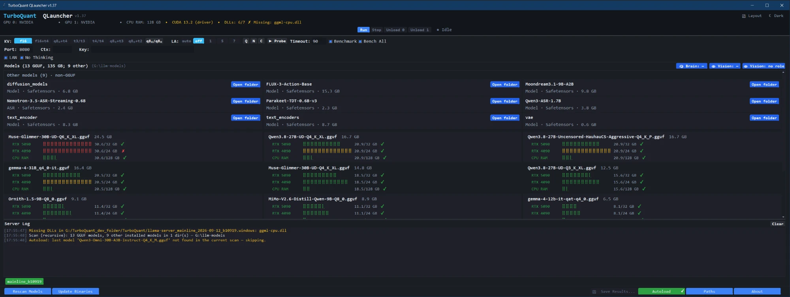

# TurboQuant QLauncher

**Model Switcher & Benchmark Tool for llama-server with TurboQuant Compression**

A lightweight desktop GUI for managing [llama-server](https://github.com/ggml-org/llama.cpp) with [TurboQuant](https://research.google/blog/turboquant-redefining-ai-efficiency-with-extreme-compression/). Launch models, switch KV configs, run benchmarks, monitor VRAM, and quick-switch between multiple llama-server builds — all without touching the command line.

TurboQuant applies Walsh–Hadamard rotation to compress transformer data at very low bit widths. Originally designed for **KV-cache compression**, the community forks are now extending the same WHT rotation to **model weights** (post-training, no retraining required). QLauncher is agnostic to both: any GGUF file, any llama-server build, any cache type.

Zero external dependencies. Python stdlib + tkinter only. Current version: **v1.37** (see [CHANGELOG.md](CHANGELOG.md)).

> **Developer repository — source only.** This repository contains the Python source, the Linux start script, the manual and a screenshot — no pre-built executables, no binaries. One file, `TurboQuant_QLauncher.py`, runs on both Windows and Linux; the platform-specific behaviour is chosen at runtime.



---

## Features

| | Feature | Description |
|---|---|---|
| ⚡ | **One-click Launch** | Double-click any model × GPU row (or press **Run**) to start llama-server. **Stop** / Escape stops it. |
| 🗂 | **Responsive Model Grid** | Model cards are laid out in columns that adapt to the window width; keyboard navigation follows the grid. |
| 📊 | **Live VRAM Bars** | Braille-style bars show effective VRAM usage — updated live when you switch KV config. Green = fits, amber = tight, red = overflow. |
| 🧠 | **Brain / Vision Roles** | Assign one model as *Brain* and one as *Vision* (header buttons). Autoload starts the Brain; the **Vision** button runs the Vision model as a second server beside it on its own port and GPU (`vision_port`, `vision_gpu_key`). |
| 👁 | **Vision Models** | A `mmproj*.gguf` next to the model is auto-attached via `--mmproj` (F16 projector preferred). |
| 📦 | **Other Models** | Non-GGUF model folders (Safetensors, PyTorch, ONNX) found during the scan are listed in a separate *Other models* section with size, status and an **Open folder** button. They are inventory only — never started. |
| 🔍 | **Multi-Directory Scan** | Up to **3 model directories** scanned together, optionally recursive. Duplicates, vocab files and files < 50 MB are skipped. |
| 🔖 | **Quick-Switch Slots** | Bookmark up to **6 llama-server builds** as one-click footer buttons. Turbo KV types and LA modes are only offered for TurboQuant builds (detected from the folder name); mainline builds get `f16` / `q8_0` only. |
| 🌐 | **LAN & API Key** | **LAN** binds the server to `0.0.0.0` instead of `127.0.0.1`. The optional **Key** field passes `--api-key`; it is masked on screen, redacted in the log and stored in a separate key file. |
| 🖥️ | **Multi-GPU** | NVIDIA (`nvidia-smi`), AMD and Intel detection plus a CPU-RAM row. `CUDA_DEVICE_ORDER=PCI_BUS_ID` routing, and the launcher checks via `nvidia-smi` which card the server really landed on. |
| ⏏ | **Unload Buttons** | One **Unload** button per GPU in the header frees everything this launcher started on that card (Brain and Vision alike); foreign processes are never touched. |
| 📈 | **Benchmarking** | Built-in llama-bench: single config (f16 baseline + selected KV) or **Bench All** matrix (KV × LA × depth 0 / 8K / 32K; only valid tuples for the active build). Configurable per-run timeout (30–1800 s). |
| ▶ | **Probe + Q/N/C Modes** | Read-only differential probe of KV × LA combinations against an f16 baseline. Results become three one-click modes: **Q**uality, **N**eutral, **C**ontext. |
| 💭 | **Reasoning Guard** | Reasoning models are detected; *No Thinking* starts the server with `--reasoning off`. |
| 🔁 | **Autoload & CLI** | Optional autostart of the Brain / last model and a local control socket for other tools (`--autostart`, `--acquire`/`--release`, `--shutdown`, `--status`, …). |
| 🔌 | **Port Conflicts** | If the port is busy, the launcher names the occupant and offers to start on a free port or stop the other process. |
| 🌗 | **Theme, Zoom, Layout** | Dark/light switch, font zoom with Ctrl+Plus / Ctrl+Minus / Ctrl+0, and **💾 Layout** to save window size and position immediately (also saved automatically). |

---

## Quick Start

### Requirements

- **Python 3.10+** with tkinter (included in the standard Windows installer; on Debian/Ubuntu: `sudo apt install python3-tk`)
- **llama-server binaries** — QLauncher works with the upstream llama.cpp build *and* with the community TurboQuant forks (see [Supported Forks](#supported-forks) below). `llama-bench` must sit next to `llama-server` for benchmarking.
- **GGUF models** (e.g. from [Hugging Face](https://huggingface.co/models?search=gguf))
- **NVIDIA GPU** with CUDA 12.x or 13.x recommended. AMD and Intel GPUs are detected; CPU-only mode works as well.

### Run — Windows

```bash
python TurboQuant_QLauncher.py
```

### Run — Linux

```bash
python3 TurboQuant_QLauncher.py
```

or use `start_qlauncher.sh`, a convenience wrapper that activates a Conda environment (`CONDA_ROOT` / `CONDA_ENV` at the top of the script, default `~/miniconda3` and `base`), checks that tkinter is importable and then starts the launcher (arguments are passed through). Edit those two variables if you use a different setup.

### First Launch

1. The **Paths** dialog opens automatically. Enter up to three model directories and bookmark your `llama-server` binaries in the **Quick-Switch Slots**.
2. Click a slot button in the footer to make that build the active engine.
3. Double-click a model × GPU row (or select it and press **Run**) to start the server.

### Files Created Next to the Launcher

Windows uses the names below; on Linux each name carries a `_Linux` suffix (e.g. `TurboQuant_QLauncher_Linux.json`, `key_Linux.json`), so both platforms can share one folder.

| File | Content |
|---|---|
| `TurboQuant_QLauncher.json` | All settings: model paths, slot bookmarks, roles, window layout, KV/LA, port, ctx, timeout, theme, zoom, Probe profiles |
| `key.json` | The optional API key (plain text, kept out of the main config — do not share it) |
| `TurboQuant_Benchmark_results.md` | Saved benchmark tables |
| `TurboQuant_QLauncher.lock` | Only while Autoload is on: PID + IPC port of the running instance |

Settings without a UI field (e.g. `update_binaries_source_path`, `vision_port`, `vision_gpu_key`, `vision_autoload`) are edited directly in the JSON file while the launcher is closed.

---

## Supported Forks

QLauncher is fork-agnostic — it works with any `llama-server` build. The Quick-Switch Slots in the footer let you bookmark up to six different binaries and switch between them with a single click. Useful for A/B-testing optimizations across forks on the same hardware.

Forks known to work with QLauncher (the `<fork>` part of the build folder name in the first column):

| Fork | Repository | Branch | Notes |
|---|---|---|---|
| `mainline` | [ggml-org/llama.cpp](https://github.com/ggml-org/llama.cpp) | `master` | Upstream baseline. **No turbo KV types** — only `f16`, `q8_0`, `q4_0`. Use as a control. |
| `thetom` | [TheTom/llama-cpp-turboquant](https://github.com/TheTom/llama-cpp-turboquant) | `feature/turboquant-kv-cache` | The reference TurboQuant integration. Adds `turbo2`/`turbo3`/`turbo4` KV types, Sparse V, weight quantization (TQ3_1S/TQ4_1S). MSVC needs the patches from issue #39. |
| `madreag` | [Madreag/turbo3-cuda](https://github.com/Madreag/turbo3-cuda) | `master` | Aggressive CUDA kernel optimizations on top of the base TurboQuant implementation: LUT scoring, `nthreads_KQ=8`, sparse V skip. Reports +13–69% decode at 32K context across RTX 5090 / 4090 / 3090 / 3090 Ti. |
| `spiritbuun` | [spiritbuun/llama-cpp-turboquant-cuda](https://github.com/spiritbuun/llama-cpp-turboquant-cuda) | `feature/turboquant-kv-cache` | Independent CUDA fork with norm correction and inverse-FWHT prefill optimization. Originally validated on RTX 3090. |
| `gemma4` | [llama-cpp-turboquant-gemma4](https://github.com/test1111111111111112/llama-cpp-turboquant-gemma4) | `master` | Gemma 4-specific turbo4 kernel optimizations for `D=256`/`D=512` head dimensions: lazy K/V, batch decode, warp-cooperative write. Built on top of the TheTom fork. |

> **Tip:** Set `CUDA_DEVICE_ORDER=PCI_BUS_ID` on mixed-architecture systems (e.g. RTX 5090 + RTX 4090). Without it, `CUDA_VISIBLE_DEVICES` can silently route to the wrong GPU. QLauncher does this automatically.

---

## Organizing llama-server Builds

Keep every build in its own folder. The folder holds `llama-server` (Windows: `llama-server.exe`), `llama-bench` for benchmarking, and the shared libraries the build needs (Windows: `llama.dll`, `ggml-*.dll`, `mtmd.dll`, and the CUDA runtime DLLs; Linux: the `lib*.so` files). Name the folder

```
llama-server_<fork>_<YYYY-MM-DD>_<build-or-commit>.<platform>
```

Builds used and tested with v1.37:

| Folder | Footer label | Source |
|---|---|---|
| `llama-server_mainline_2026-09-12_b10919.windows` | `mainline_b10919` | [ggml-org/llama.cpp](https://github.com/ggml-org/llama.cpp) |
| `llama-server_mainline_2026-10-06_b11457.linux` | `mainline_b11457` | [ggml-org/llama.cpp](https://github.com/ggml-org/llama.cpp) |
| `llama-server_spiritbuun_2026-09-24_2acf5b10.linux` | `spiritbuun_2acf5b10` | [spiritbuun/llama-cpp-turboquant-cuda](https://github.com/spiritbuun/llama-cpp-turboquant-cuda) |
| `llama-server_thetom_2026-09-23_a3d5603d.linux` | `thetom_a3d5603d` | [TheTom/llama-cpp-turboquant](https://github.com/TheTom/llama-cpp-turboquant) |

How QLauncher uses the folder name:

- **Footer label** — the `llama-server_` prefix, the `.windows` / `.linux` suffix and the `YYYY-MM-DD` segment are stripped, so the button stays short (`mainline_b10919`). The date stays in the folder name for sorting in a file manager.
- **Server family** — `mainline` in the name marks an upstream build (only `f16` / `q8_0` KV, LA off); `thetom`, `spiritbuun`, `madreag` or `turboquant` mark a TurboQuant fork with all turbo KV types and LA modes. Any other name is treated like mainline — so a Gemma 4 fork build should carry `turboquant` in its `<fork>` part (e.g. `turboquant-gemma4`) to get the turbo KV types.
- **Benchmark tables** record the full folder name, so results stay traceable to the exact build.
- The file picker in **Paths** starts in a `TurboQuant/` folder next to the launcher's folder if it exists — a convenient place to collect all build folders.

Each platform keeps its own config, so `.windows` builds only appear on Windows and `.linux` builds only on Linux. These binaries are **not** part of this repository; build them from the projects above (see [Building llama-server](#building-llama-server)).

---

## KV-Cache Configurations

| Button | Config | Compression | Best for |
|--------|--------|-------------|----------|
| `f16` | f16 / f16 | 1× (none) | Baseline, maximum quality |
| `f16+t4` | f16-K + turbo4-V | 1.6× | Safe entry point — only V is compressed |
| `q8₀+t4` | q8_0-K + turbo4-V | 2.7× | **Recommended for Q4_K_M models** |
| `t3/t3` | turbo3 / turbo3 | 5× | Maximum context length |
| `t4/t4` | turbo4 / turbo4 | 4× | Good balance |
| `q8₀+t3` | q8_0-K + turbo3-V | 2.9× | High compression, good quality |
| `q8₀+t2` | q8_0-K + turbo2-V | 3× | "Boundary V" — use with LA **auto** or **7**, never `off` |
| `q8₀/q8₀` | q8_0 / q8_0 | 2× | Standard 8-bit quantization |

The VRAM bars and ✓/✗ indicators update live as you click KV buttons (the KV-cache estimate assumes ~25 % of model size at f16). Flash Attention (`-fa on`) is enabled automatically for every quantized cache type. Turbo configs are only offered when the active build is a TurboQuant fork; mainline and unknown builds get `f16` and `q8₀/q8₀`.

---

## Layer-Adaptive Modes

| LA | Strategy | Use case |
|----|----------|----------|
| `auto` | `TURBO_LAYER_ADAPTIVE` unset — the build decides (Boundary V for turbo2-V) | Offered only for `q8₀+t2` |
| `off` | All layers equally compressed (`TURBO_LAYER_ADAPTIVE=0`) | Maximum compression |
| `1` | First 4 + last 4 layers K+V at q8_0 | **Best quality** — needs a turbo K cache |
| `5` | First/last 2 V layers at turbo4, rest turbo2 | Aggressive compression — needs a turbo V cache |
| `7` | First/last 2 V layers at q8_0, rest turbo2 ("Boundary V") | Minimal VRAM overhead — needs a turbo V cache |

Only LA modes that have a real effect for the selected KV config and build are enabled. LA modes have negligible speed impact — the benefit is output quality.

---

## Beyond KV-Cache — Weight Compression

TurboQuant is no longer just a KV-cache technique. The same Walsh–Hadamard rotation that powers `turbo3` / `turbo4` cache types is now being applied to **model weights** as a post-training quantization method, producing new `TQ3_1S` (3-bit, ~4.0 bpw) and `TQ4_1S` (4-bit, ~5.0 bpw) tensor types. No retraining, no calibration data — just `llama-quantize --allow-requantize`.

QLauncher needs no changes for this: weight-compressed models are just GGUF files with different tensor types. Drop them into any model directory and they show up in the scan like everything else.

> 📅 **As of April 2026** — Metal kernels are landing first, CUDA ports are in flight. Early PR #45 numbers show Qwen 3.5 27B dropping from ~26.6 GB to ~19.1 GB at +1.3 % PPL on Metal, while the CUDA path is still running at roughly 70 % of `q8_0` decode speed while kernels are being tuned. Track the implementation progress on [TheTom/llama-cpp-turboquant PR #45](https://github.com/TheTom/llama-cpp-turboquant/pull/45) and in [Discussion #20969](https://github.com/ggml-org/llama.cpp/discussions/20969) — both move daily.

---

## Controls

| Action | Effect |
|--------|--------|
| **Double-click** row | Launch server (or stop if running) |
| **Single click** | Select model / GPU without launching |
| **↑ ↓** | Walk the GPU rows of a card, then the card above / below |
| **← →** | Jump to the neighbouring card in the same grid row |
| **Enter** | Toggle server for selected row (or benchmark if *Benchmark* is checked) |
| **Escape** | Stop running server |
| **Click status label** | Open the server URL in the browser (LAN address when LAN is on) |
| **Run** (header) | Start the selected row — or run the benchmark if *Benchmark* / *Bench All* is checked |
| **Stop** (header) | Stop whatever is running: the server, or a benchmark after the current run |
| **Unload / Unload n** (header) | Stop everything this launcher started on that GPU |
| **🧠 Brain / 👁 Vision** (Models header) | Assign the role models; the Vision button starts / stops the Vision server |
| **💾 Layout** (header) | Save window size and position now |
| **LA: auto/off/1/5/7** | Select Layer-Adaptive mode (only valid modes are enabled) |
| **☑ Benchmark** | Double-click / Run runs llama-bench (f16 baseline + selected KV) instead of starting the server |
| **☑ Bench All** | Select all KV × LA configs (click KV/LA buttons to deselect), then click Run |
| **☑ No Thinking** | Start the server with `--reasoning off` |
| **Port / Ctx / Timeout** | Server port (default 8080) · context size `-c` (empty = model default) · llama-bench timeout per run |
| **☑ LAN / Key** | Bind to all interfaces (`0.0.0.0`) instead of `127.0.0.1` · optional `--api-key` (recommended with LAN) |
| **▶ Probe / Q N C** | Run the Probe for the selected model; afterwards Q/N/C apply and start the stored KV + LA combination |
| **Ctrl + Plus / Minus / 0** | Font zoom in / out / reset |
| **☀ / 🌙** (header) | Switch between light and dark theme |
| **Footer** | Rescan Models · Update Binaries · slot buttons · Save Results… · Autoload · Paths · About |

> **Update Binaries** copies freshly built binaries into the active server folder. Set the source folder via `update_binaries_source_path` in the config file.

---

## Probe (qnut) & Q/N/C Modes

**▶ Probe** measures how far each KV × LA combination drifts from f16 on the selected model + server build. It is read-only (the model is never modified) and takes roughly 10–25 minutes once per model + build:

1. **Phase 0** — start f16 / LA=off and record the answers to three short prompts (math, recall after ~2K tokens of filler, key-value lookup).
2. **Phase 1** — every other KV config at LA=off; each answer is compared to the baseline (score 0–3).
3. **Phase 2** — the LA modes that are valid for each KV that scored ≥ 2 (auto / 1 / 5 / 7, depending on the config).

From the scores QLauncher derives three anchors and stores them per (model, server slot) in the config file:

| Mode | Meaning |
|---|---|
| **Q** Quality | f16 baseline |
| **N** Neutral | strongest compression that still matches the baseline on all three probes |
| **C** Context | strongest compression that still matches on at least two probes |

The small score above each button shows the anchor's result (e.g. `3/3`). Probe forces *No Thinking* for the duration of the run so reasoning models give deterministic answers; your settings are restored afterwards.

---

## Autoload & CLI

The footer **Autoload** button stays locked until a server has started successfully once (`listening` in the log). When switched on:

- the assigned **Brain** model (or, without a Brain role, the last-used model) is started automatically on the next launch on its last GPU; with `vision_autoload: true` in the config the Vision server follows,
- a control socket on `127.0.0.1` (random port, written to the lock file) accepts commands from other tools.

```bash
python TurboQuant_QLauncher.py --autostart            # open GUI and start the Brain / last model (forwarded if already running)
python TurboQuant_QLauncher.py --autostart --minimized
python TurboQuant_QLauncher.py --autostart --model M.gguf --gpu "GPU 0"   # this model, this run only
python TurboQuant_QLauncher.py --no-autostart         # open GUI without autoload
python TurboQuant_QLauncher.py --acquire TOKEN        # autostart owned by another app (single-use token)
python TurboQuant_QLauncher.py --release TOKEN        # unload only the models started for TOKEN
python TurboQuant_QLauncher.py --shutdown             # close a running instance cleanly
python TurboQuant_QLauncher.py --status               # print JSON status of the running instance
python TurboQuant_QLauncher.py --version
```

`--shutdown`, `--status` and `--release` only reach an instance that has Autoload enabled. `python TurboQuant_QLauncher.py --help` lists all flags. On Linux the same flags can be passed to `start_qlauncher.sh`.

---

## Benchmark Output

After a run, click **💾 Save Results…** in the footer to append the results as a Markdown table to `TurboQuant_Benchmark_results.md` (Linux: `TurboQuant_Benchmark_results_Linux.md`) — ready for GitHub posts:

```markdown
### model.gguf — RTX 4090, Build CUDA 12.8 (sm_89;120), Driver 13.2, 2026-04-04

| KV-Cache          | pp512 (t/s) | tg128 (t/s) | Δ Prefill | Δ Decode |
|-------------------|-------------|-------------|-----------|----------|
| **LA=off**        |             |             |           |          |
| f16 (default)     | 10,112.60   | 150.59      | —         | —        |
| q8_0-K + turbo4-V | 10,808.36   | 136.37      | +6.9%     | -9.4%    |
| ...               |             |             |           |          |
```

Each run includes model name, GPU, CUDA build version (sm targets), driver version, engine folder and timestamp. Bench All tables are grouped by LA mode and depth (`d=0`, `d=8192`, `d=32768`). Models whose path contains a comma are marked with ⚠ and refused by the benchmark, because llama-bench splits arguments at commas.

---

## Benchmark Findings

> 📅 **Snapshot: April 2026** — The numbers below are a point-in-time capture from a single hardware setup and a single fork build. TurboQuant kernels are being tuned weekly across all five forks, so individual figures and the "best config" recommendation can and will move. Use this as a reference shape, not as a current ranking. For the latest community results check [Discussion #20969](https://github.com/ggml-org/llama.cpp/discussions/20969).

Tested on AMD 9950X3D · 64 GB DDR5 · RTX 5090 (32 GB) + RTX 4090 (24 GB).
Build: spiritbuun `feature/turboquant-kv-cache` · CUDA 12.8 · `-DGGML_CUDA_FA=ON -DGGML_CUDA_FA_ALL_QUANTS=ON`.

### Key Results — Meta-Llama-3.1-8B-Instruct-Q4_K_M · LA=1

| Config | RTX 4090 (Ada, sm_89) | RTX 5090 (Blackwell, sm_120) |
|---|---|---|
| f16 baseline | 10,077 / 150.2 t/s | 12,761 / 231.9 t/s |
| q8₀+t4 | +8.7% / **-6.9%** | -3.2% / **-25.2%** |
| q8₀+t3 | +8.5% / **-8.2%** | -2.7% / **-30.2%** |
| t3/t3 | +3.8% / **-14.9%** | -7.5% / **-39.7%** |

### Notable Findings

- **Ada (sm_89) currently handles TurboQuant decode significantly better than Blackwell (sm_120).** In this snapshot the RTX 4090 loses only ~7 % decode with q8₀+t4, while the RTX 5090 loses ~25 %. This matches the structural explanation that Ada's int8 `dp4a` instructions align well with the current TurboQuant dequant path — but Blackwell-specific kernels are an active work item, so expect this gap to close.
- **LA=1 improves decode speed in addition to quality** on this build. The q8_0 layers at critical positions use the faster native int8 decode.
- **CUDA 12.8 ≈ CUDA 13.2 on this hardware** for TurboQuant workloads. `sm_120a` provided no measurable benefit over `sm_120` in our test runs.
- **Working recommendation on this setup:** `q8_0-K + turbo4-V` with `LA=1` — best balance of compression, speed, and quality *at the time of measurement*. Re-run the Bench All matrix after any fork update.

---

## Building llama-server

The build flags below work for **any** of the supported TurboQuant forks. Just substitute the repository URL and branch from the [Supported Forks](#supported-forks) table. The example uses the spiritbuun fork:

```cmd
git clone --branch feature/turboquant-kv-cache --depth 1 ^
  https://github.com/spiritbuun/llama-cpp-turboquant-cuda.git

cd llama-cpp-turboquant-cuda

cmake -B build -DGGML_CUDA=ON -DGGML_NATIVE=ON ^
  -DGGML_CUDA_FA=ON -DGGML_CUDA_FA_ALL_QUANTS=ON ^
  -DCMAKE_CUDA_ARCHITECTURES="89;120" ^
  -DCMAKE_BUILD_TYPE=Release

cmake --build build --config Release -j
```

`CMAKE_CUDA_ARCHITECTURES="89;120"` builds for Ada (RTX 4090, sm_89) **and** Blackwell (RTX 5090, sm_120) in one binary. Drop one of the values if you only need a single architecture.

After building, copy `llama-server.exe`, `llama-bench.exe` and the matching DLLs into their own build folder (see [Organizing llama-server Builds](#organizing-llama-server-builds)), then add the `llama-server.exe` to a Quick-Switch slot in QLauncher → Paths. On Windows the header shows whether all required DLLs (including `cublas64_12/13.dll`) are present.

On **Linux** use the same `cmake` flags (with `\` instead of `^` as line continuation) and either copy the binaries and `.so` files into a named build folder or point a slot directly at `build/bin/llama-server` — in that case the slot label is taken from the project folder above `build/bin`.

> 📅 **MSVC note (as of April 2026):** Building the TheTom fork on Windows currently needs a handful of manual patches (`M_PI` define, `extern` visibility fixes, etc.). Add `#define _USE_MATH_DEFINES` and `#include <math.h>` at the top of `ggml/src/ggml-turbo-quant.c` and see [issue #39](https://github.com/TheTom/llama-cpp-turboquant/issues/39) for the full set. These are likely to land upstream at some point — check the issue status before patching.

> **Multi-GPU note:** Set `CUDA_DEVICE_ORDER=PCI_BUS_ID` for correct GPU routing on mixed-architecture systems. QLauncher does this automatically for every server it launches.

---

## For Developers

- Everything lives in `TurboQuant_QLauncher.py`; there is no build step. Check syntax with `python -m py_compile TurboQuant_QLauncher.py` and test changes by running the GUI on the platform you touched (Windows and Linux share the same code paths, switched by `IS_WINDOWS`).
- Many source comments are in German and carry internal work-package tags (`AP-QL-xx`); they document why a piece of code looks the way it does.
- Keep the repository source-only: no compiled launchers, no llama.cpp binaries, no personal config or key files.
- The code base is large (~14k lines in a single file), and in practice it is maintained with an AI coding assistant such as Claude Code. Using one to navigate, change and review the code is the easiest way in.

---

## Documentation

- `TurboQuant_QLauncher_Manual.pdf` — user manual (covers v0.58; newer features such as roles, Vision server, LAN/API key and Unload are described in this README).
- [CHANGELOG.md](CHANGELOG.md) — version history.

---

## Related Projects

**Forks tested with QLauncher:**

- [ggml-org/llama.cpp](https://github.com/ggml-org/llama.cpp) — Upstream llama.cpp (mainline baseline)
- [TheTom/llama-cpp-turboquant](https://github.com/TheTom/llama-cpp-turboquant) — Reference TurboQuant integration (`feature/turboquant-kv-cache`)
- [Madreag/turbo3-cuda](https://github.com/Madreag/turbo3-cuda) — Aggressive CUDA kernel optimizations
- [spiritbuun/llama-cpp-turboquant-cuda](https://github.com/spiritbuun/llama-cpp-turboquant-cuda) — Independent CUDA fork with norm correction
- [llama-cpp-turboquant-gemma4](https://github.com/test1111111111111112/llama-cpp-turboquant-gemma4) — Gemma 4 D=256/512 head optimizations

**Other resources:**

- [TheTom/turboquant_plus](https://github.com/TheTom/turboquant_plus) — TurboQuant research workspace (benchmarks, quality validation, writeups)
- [Discussion #20969](https://github.com/ggml-org/llama.cpp/discussions/20969) — Community benchmarks & findings

---

## Acknowledgements

- **spiritbuun** — TurboQuant CUDA kernels, norm correction, fused FA
- **TheTom** — turboquant_plus, block_size=128 optimization, Metal support
- **seanrasch** — Ampere benchmarks, 256K context dual-GPU validation
- **AmesianX** — Blackwell / TurboQuant v1.4.0, IWHT FP16 bug fix
- **primoco** — Accuracy benchmarks (100% math accuracy with q8_0-K/tq4_0-V)

TurboQuant refers to the paper by Zandieh et al. ([arXiv:2504.19874](https://arxiv.org/abs/2504.19874), ICLR 2026, Google Research). This tool is an independent community project, not affiliated with Google.

---

## License

MIT — © WaveboSF 2026

Built with assistance from Claude (Anthropic).
