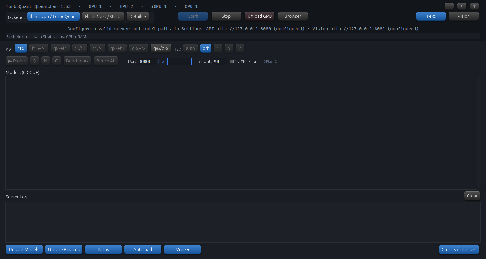

# TurboQuant QLauncher

**A desktop launcher for local LLMs with llama.cpp / TurboQuant, Flash-Next / Strata and Xolotl.**

Choose a model, an inference server and a device in one window. QLauncher helps you manage server builds, context settings and benchmarks, and opens the local server in your browser.

**[Download QLauncher 1.54 for Linux or Windows](https://github.com/WaveboSF/TurboQuant-QLauncher/releases/latest)** · [Get a server build](#get-a-llama-server-build) · [What's new](CHANGELOG.md)

Under **Assets**, choose `TurboQuant_QLauncher-Linux-1.54.tar.gz` for Linux or `TurboQuant_QLauncher-Windows-1.54.zip` for Windows. Extract the entire archive before starting.

The launcher is a native Rust application; it does not require Python. **Models and inference servers are separate downloads.**

## Quick start

1. Download your platform's archive from [Releases](https://github.com/WaveboSF/TurboQuant-QLauncher/releases/latest) and extract the **entire folder**.
2. Get a compatible [llama-server build](#get-a-llama-server-build) and a GGUF model, for example from [Hugging Face](https://huggingface.co/models?search=GGUF).
3. On Windows, double-click `TurboQuant_QLauncher-Windows.exe`. On Linux, open `TurboQuant_QLauncher-Linux` or run `./TurboQuant_QLauncher-Linux` in a terminal from the extracted folder.
4. Open **Paths**. Add your model folder and select `llama-server` / `llama-server.exe`. To find several server builds, choose **Find server builds…** and select their parent folder. Save the settings.
5. Select a model and a device, then press **Start**. Once the server is ready, **Browser** opens its local address.

Windows may ask to open Microsoft's official [Visual C++ Redistributable](https://learn.microsoft.com/en-us/cpp/windows/latest-supported-vc-redist/) download. Run the installer if the runtime is missing, then reopen QLauncher.

## Get a llama-server build

1. Open the official [llama.cpp releases](https://github.com/ggml-org/llama.cpp/releases). Choose a release with **Assets** for your operating system and hardware. Build releases are usually named `b…`; if a release has no binaries, choose another one with matching assets.
2. For NVIDIA GPUs, look for a **CUDA** archive for Linux or Windows and a CUDA version supported by your driver. CPU, Vulkan and other variants are listed when the project provides them. Follow that release's instructions for any separately offered matching `cudart` libraries.
3. Extract each build into its own folder, keeping `llama-server`, optional `llama-bench`, and the supplied libraries together. In QLauncher use **Paths → Find server builds…**, or browse directly to the server executable.

For **TurboQuant KV-cache types**, use a compatible community build rather than assuming they are present in the upstream build:

- [TheTom / llama-cpp-turboquant — releases](https://github.com/TheTom/llama-cpp-turboquant/releases) and [project](https://github.com/TheTom/llama-cpp-turboquant). Available platform archives vary by release; select one containing `llama-server`.
- [spiritbuun / buun-llama-cpp](https://github.com/spiritbuun/buun-llama-cpp) — see its build instructions and releases for available binaries.
- [turbo-tan / llama.cpp-tq3](https://github.com/turbo-tan/llama.cpp-tq3) — TQ weight formats and related kernels; consult the project's build instructions.

If no prebuilt server matches your platform, follow the respective project's build instructions. Model, device and cache-type support depend on the chosen build.

QLauncher recognizes these fork families from the server path. Include `turboquant`, `thetom` or `spiritbuun` in the relevant build-folder name so its TurboQuant cache choices appear; use only cache types supported by that server.

**Update Binaries** uses a separately configured local build source folder; it does not download server builds from GitHub. To download models, the **More** menu also offers Hugging Face searches.

## Features

- Choose **llama.cpp / TurboQuant**, **Flash-Next / Strata**, or **Xolotl** for compatible models and profiles.
- **Comb.GPU:** distribute one model across compatible NVIDIA GPUs with a supporting llama.cpp server. For a full-GPU run, the assigned model layers and cache must fit the available memory on each selected device.
- Editable context, supported KV-cache choices, model switching, server status, optional Autoload and benchmarking with compatible tools.
- **DFlash2 for Ripple:** optional Q4 draft and one draft token. The Linux package includes a memory-estimation helper for the CUDA build of [llama.cpp b12503](https://github.com/ggml-org/llama.cpp/releases/tag/b12503); obtain the [Q4 draft GGUF](https://huggingface.co/ashbash/Ripple-65B-Preview-DFlash2-GGUF) separately and configure it under **Paths → Engine**. A matching helper for Windows must be supplied separately and has not yet been tested there.
- Text and Vision controls for separately configured compatible models. **More** offers model searches; **Credits / Licenses** shows acknowledgements and notices.

For Strata, follow the [Strata installation instructions](https://github.com/Niko1221/Strata) and configure its executable and the compatible model profile under **Paths → Engine**. Strata and its models have their own requirements and licenses.

For Inkling with [Xolotl](https://github.com/Indras-Mirror/Xolotl), install Xolotl separately and configure its executable, source folder, and a compatible profile under **Paths → Engine**. See `docs/XOLOTL.md` in the downloaded package. This integration was tested on Linux; Windows support has not yet been verified.

## Credits and licenses

Thank you to [Indras-Mirror and the Xolotl contributors](https://github.com/Indras-Mirror/Xolotl) for Xolotl and its Inkling engine.

Thank you to the [llama.cpp](https://github.com/ggml-org/llama.cpp), [Strata](https://github.com/Niko1221/Strata), [TheTom](https://github.com/TheTom/llama-cpp-turboquant), [spiritbuun](https://github.com/spiritbuun/buun-llama-cpp) and [turbo-tan](https://github.com/turbo-tan/llama.cpp-tq3) teams and contributors. TurboQuant is based on [research by Zandieh et al.](https://arxiv.org/abs/2504.19874).

DFlash2 builds on the original [DFlash research and project](https://github.com/z-lab/dflash) and [Inco AI's DFlash2 work](https://inco.ai/blog/dflash2/). Thanks to [SubSir and the llama.cpp contributors](https://github.com/ggml-org/llama.cpp/pull/27342), [iSevenDays and contributors](https://github.com/ggml-org/llama.cpp/pull/31904), [Ricursive Intelligence](https://huggingface.co/ricursiveAI/Ripple-65B-Preview-DFlash2) and [ashbash](https://huggingface.co/ashbash/Ripple-65B-Preview-DFlash2-GGUF) for the engine, models and conversion.

We also thank [seanrasch](https://github.com/seanrasch), [AmesianX](https://github.com/AmesianX), [primoco](https://github.com/primoco), and the [Rust](https://www.rust-lang.org/), [Tcl/Tk](https://www.tcl-lang.org/), [FreeType](https://freetype.org/) and [Ubuntu Font Family](https://design.ubuntu.com/font/) contributors. Development and documentation were assisted by [Claude](https://www.anthropic.com/claude) and [OpenAI Codex](https://openai.com/codex/).

QLauncher is an independent community project under the [MIT License](LICENSE). Both release packages include the full third-party notices and licenses; external servers and models carry their own terms.

## Older Python version

The [legacy folder](legacy/) contains the historical Python launcher and older manual. The current native launcher is distributed through the binary releases. GitHub's automatically generated release source archives contain the older Python repository, not the current native Rust source.
